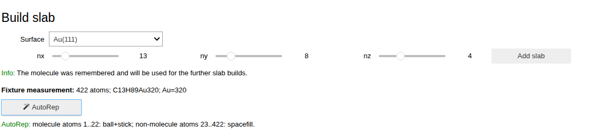
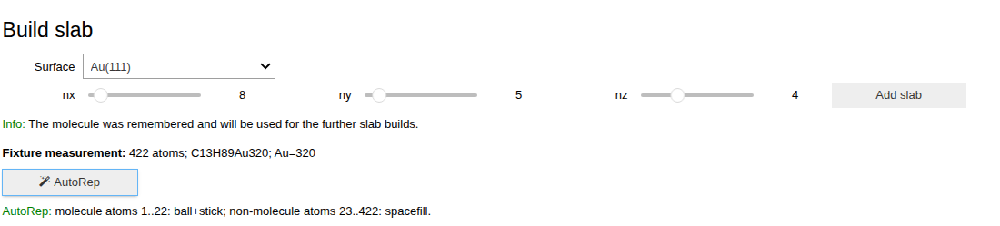
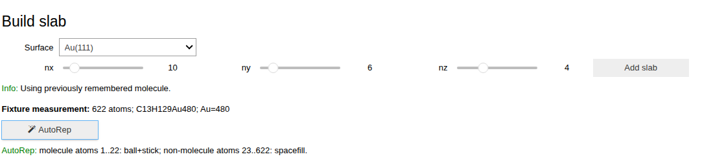

# Au(111) slab-size selector regression

The Build slab panel must retain the chosen nx/ny/nz after Add slab and a
subsequent rebuild. The generated Au(111) slab has `2 * nx * ny * nz` Au atoms
and `2 * nx * ny` bottom-passivation H atoms.

The original behavior is a synchronous widget-feedback problem. The structure
manager sends the combined molecule/slab back to the builder before InputDetails
refreshes the earlier molecule classification. The size suggestion then uses
the entire combined structure and overwrites the already chosen nx/ny. The
generated slab still reflects the original choices.

The fix suppresses this size suggestion only while the builder publishes its
own output through the manager. New molecule inputs and deliberate surface
changes still receive size suggestions. Slab generation, molecule placement,
passivation, cells, atom ordering and scientific settings are unchanged.

## Real GUI evidence

These are direct Chromium element screenshots from an independent notebook,
using the actual BuildSlab, StructureManagerWidget, InputDetails and AutoRep
links. The input is a separate C13H9 phenalenyl fixture. The visible fixture
measurement is derived from the generated ASE structure, independently of the
selector values. No image was retouched. No live openBIS object, user form,
stored scientific node or HPC job was used.

The before case loads the unchanged builder from master
`996fba4b0095ee3ec7d170243b95b700d1b0a493`; the after cases load this patch.

### Before: selectors disagree with the generated structure

After entering 8, 5, 4 and clicking Add slab once, the controls show 13, 8, 4.
The structure still contains 320 Au and 422 atoms, C13H89Au320. AutoRep reports
molecule atoms 1..22 and non-molecule atoms 23..422.

### After: 8 by 5 by 4 is retained

The same single click keeps 8, 5, 4 and generates the same 320 Au / 422 atoms,
with unchanged molecule/non-molecule ranges.

### After: rebuild with 10 by 6 by 4

Editing the slider readouts, pressing Enter to commit each value, and clicking
Add slab once retains 10, 6, 4. The rebuilt structure has 480 Au / 622 atoms,
C13H129Au480. It contains the original molecule once; AutoRep reports 1..22
and 23..622.

## Automated coverage

`tests/test_slab_size_selectors.py` exercises the actual manager-to-builder and
manager-to-InputDetails links in the production notebook's ordering, with a
temporary AiiDA SQLite profile. It checks selector values, Au/passivation and
total counts, cell lengths, molecule order and pair distances, AutoRep ranges,
and continued suggestions for a new molecule or surface. It also rejects any
size-guess call on the generated slab during build/rebuild.

On unchanged master the build regression reproduces `(13, 8, 4)` instead of
`(8, 5, 4)`. Both focused cases pass with the fix; the full suite passes 491
tests. No calculation submission or app installation is part of this evidence.
